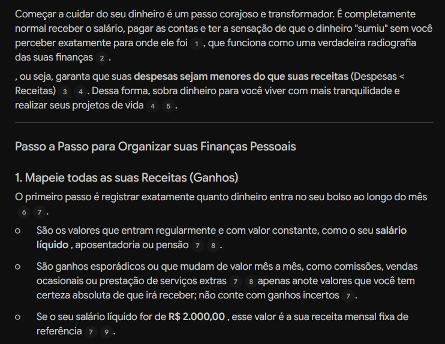
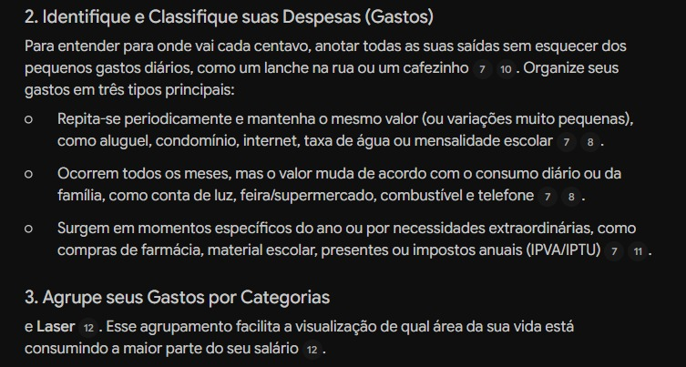
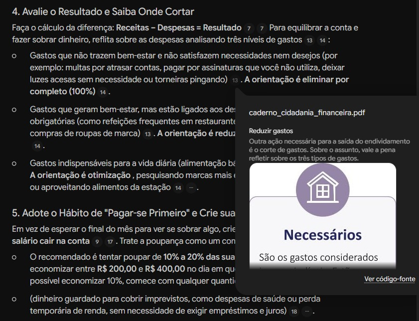
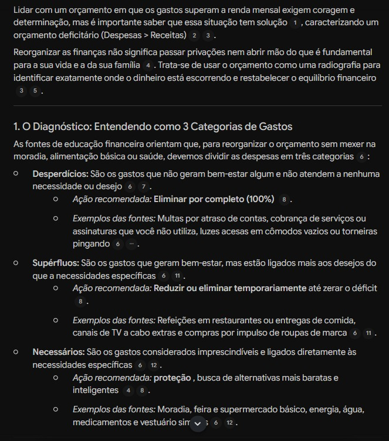
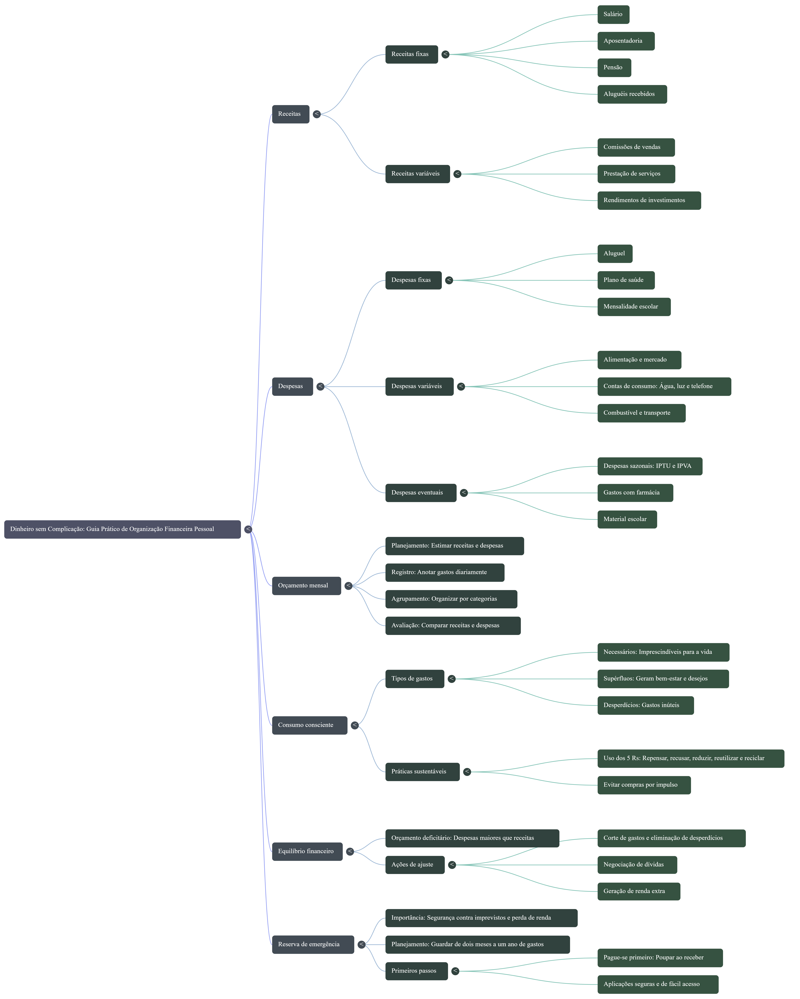

# Dinheiro sem Complicação

**Um segundo cérebro com inteligência artificial para aprender a organizar as finanças pessoais.**

[**Acessar o notebook público**](https://notebook.google.com/notebook/743e1a75-4ece-4a03-8f53-e6ced023c0c7)

> Para abrir o notebook e conversar com as fontes, é necessário entrar com uma Conta Google.

## Objetivo

Ajudar pessoas que estão começando a cuidar do dinheiro a compreender suas receitas e despesas, identificar desperdícios, construir um orçamento mensal e dar os primeiros passos para criar uma reserva de emergência, por meio de explicações simples e fundamentadas em fontes confiáveis.

## Como funciona

O projeto foi construído no **NotebookLM (Gemini Notebook)** com materiais de educação financeira selecionados. O usuário pode fazer perguntas em linguagem natural, consultar respostas com referências às fontes e utilizar o guia e o mapa mental para estudar.

O conteúdo tem finalidade educativa. O notebook não substitui orientação profissional individualizada nem recomenda investimentos específicos.

## Fontes selecionadas

| Fonte | Formato | Por que foi escolhida |
| --- | --- | --- |
| [Banco Central — Caderno de Educação Financeira](https://www.bcb.gov.br/content/cidadaniafinanceira/documentos_cidadania/Cuidando_do_seu_dinheiro_Gestao_de_Financas_Pessoais/caderno_cidadania_financeira.pdf) | PDF | Material institucional sobre gestão de finanças pessoais, orçamento e consumo consciente. |
| [SUSEP — Orçamento pessoal e familiar](https://www.gov.br/susep/pt-br/assuntos/meu-futuro-seguro/educacao-financeira/orcamento-1) | Artigo | Orientações públicas para compreender receitas, despesas e planejamento. |
| [CVM — Planeje seus gastos](https://www.gov.br/investidor/pt-br/investir/antes-de-investir/organize-a-sua-vida-financeira/passo-03-planeje-os-seus-gastos) | Artigo | Explica o papel do orçamento e das escolhas de consumo. |
| [Banco Central — Lidando com imprevistos](https://www.bcb.gov.br/cidadaniafinanceira/lidando-imprevistos) | Página web | Apoia o aprendizado sobre proteção financeira e imprevistos. |
| [Banco Central — Aprender Valor](https://www.youtube.com/watch?v=tlP8CboHMTo) | Vídeo | Complementa os textos com conteúdo audiovisual de educação financeira. |

As referências são apresentadas para consulta; o acesso e as condições de uso de cada material permanecem sujeitos às regras dos respectivos titulares.

## Diretriz do notebook

O chat foi configurado para atuar como **educador financeiro especializado em orçamento doméstico**, com estas orientações:

- Responder em português brasileiro, de maneira simples e respeitosa.
- Basear as respostas nas fontes selecionadas, apresentando citações verificáveis.
- Explicar conceitos com exemplos cotidianos e valores em reais.
- Ensinar a identificar receitas, despesas e oportunidades de ajuste no orçamento.
- Propor atividades práticas e respeitar a realidade financeira de cada pessoa.
- Reconhecer quando as fontes não sustentarem uma afirmação.
- Diferenciar valores hipotéticos de dados reais e não prometer resultados ou recomendar produtos financeiros específicos.

## Testes realizados

### Teste 1 — Como começar a organizar as finanças?

**Pergunta:**

> Sou uma pessoa que nunca fez um controle financeiro. Recebo meu salário todos os meses, pago minhas contas, mas não sei exatamente para onde vai meu dinheiro. Como posso começar a organizar minhas finanças pessoais? Explique passo a passo, com exemplos simples e uma atividade prática que eu possa realizar hoje. Utilize as fontes do notebook e apresente as citações que sustentam suas orientações.

**Síntese da resposta:** o notebook orientou a mapear receitas, registrar e classificar despesas, agrupar gastos, analisar o resultado do orçamento e iniciar uma reserva quando houver condições. Também apresentou um orçamento ilustrativo e uma atividade de registro de gastos.

**Evidências e fontes:** as capturas mostram citações numeradas no texto e a abertura de um trecho do **Caderno de Educação Financeira do Banco Central**, relacionado à classificação e redução de gastos.

### Teste 2 — O que fazer quando os gastos superam a renda?

**Pergunta:**

> Uma pessoa recebe R$ 2.500 líquidos por mês, mas suas despesas chegam a R$ 2.800. Como ela pode reorganizar o orçamento para eliminar esse déficit de R$ 300 sem comprometer necessidades básicas, como moradia, alimentação e saúde? Apresente um plano prático, com prioridades e exemplos. Fundamente suas orientações nas fontes do notebook.

**Síntese da resposta:** o notebook identificou o déficit de **R$ 300**, diferenciou desperdícios, gastos supérfluos e necessários e propôs um plano ilustrativo de redução de despesas, além de alternativas como renegociação e aumento de renda. Os valores de economia apresentados são **hipóteses**, não resultados garantidos.

**Evidências e fontes:** a captura mostra citações numeradas para os conceitos de orçamento deficitário, classificação de gastos e orientações de ajuste. Os marcadores permitem consultar os trechos originais no notebook público.

## Materiais de estudo

- [Guia em PDF — 7 passos para organizar suas finanças](guia-dinheiro-sem-complicacao.pdf)
- [Mapa mental em PNG](mapa-mental.png)

## Como utilizar

1. Acesse o [notebook público](https://notebook.google.com/notebook/743e1a75-4ece-4a03-8f53-e6ced023c0c7) com sua Conta Google.
2. Consulte as cinco fontes disponíveis.
3. Faça uma pergunta sobre orçamento ou organização financeira.
4. Clique nas citações da resposta para conferir os materiais usados.
5. Utilize o guia e o mapa mental para estudar e colocar as orientações em prática.

## Limitações e cuidados

As respostas são geradas por IA e devem ser conferidas nas fontes citadas. Exemplos e percentuais não substituem um diagnóstico individual. Não insira no chat dados financeiros sensíveis, senhas, números de conta ou documentos pessoais.
